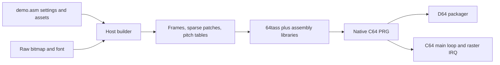

# Algorithms and design decisions

This guide describes the implementation as it exists, including its constraints.
The same summaries appear in the corresponding source-file headers. Detailed
cross-file formats and artifact provenance are documented below.

## How the parts fit together



Host work deliberately trades build time and stored data for less C64 work.
The machine calculates no sine or exponential functions. Its main thread
decodes patches, and its interrupt handler schedules display changes, reads
input, advances the SID sequencer and shifts the ticker.

## demo.asm

[Source](../demo.asm)

Application composition: this is the single place for image/font paths, text, palette, wave geometry, show settings, exported music and output filenames. Algorithm: declare literal DEMO_* constants, include the engine, then append text/font/music and the generated bitmap/patch data in the engine memory map. Why: 64tass and the host builder read the same settings, avoiding a second application-specific JavaScript configuration that could drift out of sync. Use literal values: host/config.cjs is a small reader, not an assembler parser. Lists are powers of two where the runtime wraps indices with AND masks. Binary artwork stays external so it can be replaced without rewriting code.

## lib/state.asm

[Source](../lib/state.asm)

Algorithm: assign a shared zero-page ABI; this file emits no runtime bytes. Why: zero-page accesses and indirect pointers keep the 6510 decoder small and fast. Explicit addresses also make memory ownership inspectable in VICE. State groups: animation/scheduling, input edges, audio/ticker clocks, glyph scratch, and src/dst pointers. All participating modules use these symbols. Tradeoff: these modules share an ABI and are not independently relocatable. The boot clear covers $02..$4f; src/dst are initialized by render before use.

## lib/engine.asm

[Source](../lib/engine.asm)

Algorithm: assemble the runtime modules in a fixed order, then emit the palette and the 23 body-row screen-address words needed by the color updater. Why: source includes add no linking/runtime overhead and preserve layout. Boot deliberately falls through into the player: keep player.asm immediately after boot.asm. Forward references to application assets resolve in 64tass. Include once after DEMO_* constants; data and assets follow in the application. This is a cohesive engine with shared state, not a collection of object files.

## lib/boot.asm

[Source](../lib/boot.asm)

Algorithm: emit BASIC SYS2064, take over hardware, clear state, initialize both bitmap/color buffers, measure raster length, install vectors, enable IRQ. Why: the BASIC stub loads normally from disk; ROMs are mapped out so the second bitmap can occupy RAM under KERNAL while I/O remains accessible. The startup copy is unrolled by pages: 31*256 + 64 = exactly 8000 bytes. Copying a full 8192 bytes would overwrite the interrupt-vector area. Raster measurement distinguishes standard PAL from NTSC without a ROM flag. Tradeoff: startup owns the machine and exits by reset, not by returning to BASIC.

## lib/player.asm

[Source](../lib/player.asm)

Algorithm: state machine for idle, two-buffer warm-up, steady playback and static restoration. Render the hidden buffer, request its scheduled flip, advance phase with a mask, and add integer/fractional periods to the deadline. Why: absolute deadlines include rendering time instead of adding a delay after drawing; each hidden buffer is two phases behind the next target. Warm-up patches start both buffers from static. The universal restore patches both buffers on stop so the next start has a known baseline and no trails. Tradeoff: arbitrary frame jumps need new patches; missed deadlines can slow playback. Overdue frames resync at the next refresh and increment a counter, preventing accumulated lateness from wrapping the signed deadline comparison.

## lib/bitmap.asm

[Source](../lib/bitmap.asm)

Algorithm: stream sparse commands into the hidden bitmap. 0 ends the stream; 1..127 skips; $81..$ff copies literals; $80,count,value fills 1..255 bytes. Why: skips change only the destination pointer, and literal loops use indexed indirect reads/writes. Literal copies count backward with DEY/BPL; fill loops count down in X. Pointers still advance once per whole run. Literal zeros erase old pixels; skips preserve the buffer-specific baseline. Input A is a valid patch index. Clobbers A/X/Y, flags, src/dst/count and patch_tail. A low-stream terminator switches source without resetting dst. Only builder-validated streams are supported: runtime does not bounds-check. IRQ scans keys every refresh; main polls between frames. Avoiding per-command input calls leaves CPU time for the larger set of shorter compressed runs.

## lib/display.asm

[Source](../lib/display.asm)

Algorithm: main-thread flip sets a request and waits. The raster ISR calls flip_border when the deadline is due, selects the other VIC bank/screen, records the tick and clears the request to release the waiting main thread. Why: switch complete frames at raster line 250, before expensive ISR work, so the viewer never sees a half-decoded bitmap or a late mid-picture flip. Only the low two CIA2 port bits change; unrelated output bits are preserved. Tradeoff: flip blocks and requires enabled IRQs; it must not run inside an ISR.

## lib/raster.asm

[Source](../lib/raster.asm)

Algorithm: save A/X/Y, advance ticks, scan keys, service due flips, update one color band, then use an accumulator to schedule approximately 50 logic ticks per second on nominal 50/60 Hz displays. Every other logic tick scrolls text. Why: flips run first to meet the border deadline. Music/ticker scheduling is decoupled from the slower bitmap animation; accumulator arithmetic uses bytes. On NTSC, add 50 and subtract 60 when due: five logic updates per six refreshes. Acknowledge VIC IRQ and restore registers; RTI restores caller flags. Tradeoff: color bands update per refresh, and real crystal rates are approximate; ISR work still consumes the same CPU budget used by the main-thread decoder.

## lib/keyboard.asm

[Source](../lib/keyboard.asm)

Algorithm: select CIA keyboard rows and interpret active-low matrix bits. Track prior Space/M/number states so a held key causes one action per edge. Space toggles a one-bit request; number keys store a mode request; M changes music volume. Built-in music advances muted; an imported player pauses/restarts. Why: scanning in both IRQ and main code catches short taps. PHP/SEI/PLP keeps shared edge state atomic while preserving the caller interrupt-enable state. IRQ scans every refresh; main polls between frames and while waiting to flip. Optional poll_render_keyboard scans every eight calls for other renderers. Tradeoff: this is edge suppression, not timed mechanical debouncing or an event queue. Multiple pending Space edges can cancel; numbers have ascending priority.

## lib/effects.asm

[Source](../lib/effects.asm)

Algorithm: atomically consume the pending mode, then set effect and request animation start or stop only if the current active state needs to change. Why: keyboard scanning reports intent; this main-thread controller decides when the player can safely transition and restore its dependent buffers. Modes 1/2 and optional 4..6 share the same wave frames with different color treatments. Mode 3 stops bitmap motion while the raster-driven palette keeps changing. CMP after PLP tests the request value, not the previously restored flags. Tradeoff: color fields reuse the existing logo; new bitmap motion needs matching data.

## lib/colors.asm

[Source](../lib/colors.asm)

Algorithm: update 40 screen-color bytes for one body row in both VIC banks. Use the base color for mode 1, row bands for 2/3, or optional fields for 4..6. After all 23 rows, wrap the row and advance the palette phase. Why: hires bitmap foreground/background colors live in the screen matrix; changing those bytes recolors the logo without touching its bitmap pixels. One row per refresh bounds ISR work; both copies stay valid for future flips. The two text rows remain untouched. The second screen is a fixed $bc00 away. Tradeoff: bands are eight pixels high; a sweep is 23 refreshes, so PAL and NTSC color-cycling speeds differ even though wave/music/ticker timing is normalized.

## lib/scroller.asm

[Source](../lib/scroller.asm)

Algorithm: fetch a null-terminated text byte, map it with AND 63, load its eight glyph rows and feed one most-significant glyph bit into each row shift. Propagate carry right-to-left through 40 bitmap cells with ROL, then mirror each result into the other buffer. After eight shifts load another glyph. Why: smooth single-pixel text uses existing bitmap memory and survives flips. The 40-cell inner operation is assembler-unrolled to avoid address arithmetic. Tradeoff: larger code and substantial ISR work; only the 64-glyph uppercase font subset is supported, not arbitrary Unicode or full PETSCII translation. The bottom row is reserved: motion patches must never overwrite ticker bytes.

## lib/sid.asm

[Source](../lib/sid.asm)

Algorithm: initialize SID presets, advance a note-duration counter at the logic rate, read three PAL/NTSC frequency pairs, write pitch and assert gates. Clear gates one logic tick before the next note; wrap the step with an AND mask. Why: SID generates the actual waveforms/envelopes in hardware. Tables remove floating-point pitch calculations from the C64 and compensate for SID clocks. The three fixed presets are pulse lead, triangle bass and sawtooth arpeggio. Tradeoff: this is a small equal-step note sequencer, not a general SID player. It has no rest opcode, filters, swing or per-note instruments; MIDI 0 is a note. PAL table selection relies on the engine invariant period=5 for PAL, 6 for NTSC.

## lib/assets.asm

[Source](../lib/assets.asm)

Algorithm: emit the patch-address table, place the static bitmap at $2000, place streams at $4000 and optionally $1500; reject code/data overlap. Why: fixed locations match VIC bank addressing and avoid runtime relocation. Host allocation and assembler assertions independently enforce the layout. Code/font/pointers fit below $1500 when low patches are used, else $2000. High streams plus optional fields end by $c000. Tradeoff: generated paths and memory regions are a shared project contract; changing the layout requires coordinated edits to the host allocator and runtime.

## build.cjs

[Source](../build.cjs)

Algorithm: parse the application constants, fit artwork and add HUD, generate wave frames, encode/verify two-buffer patches, allocate streams, emit assets, run 64tass, package a D64 and write a build report. Why: expensive image/sine/pitch work is done once on the host; the C64 plays validated data. Fixed memory limits fail during build, before producing overlap. Paths resolve from the application file; compiler selection is overridable. Tradeoff: generated/ is shared by entries in one project: builds must be serial. The build report records paths/sizes, not a proof of runtime timing for every image.

## host/config.cjs

[Source](../host/config.cjs)

Algorithm: recognize literal DEMO_* assignments with a constrained regex, translate assembler hexadecimal numerals outside strings, then JSON-decode. Validate byte ranges, font text, equal voice lengths, and power-of-two masks. Why: one assembly application file serves both assembler and host, without executing arbitrary JavaScript or maintaining a second configuration format. Tradeoff: this is intentionally not a 64tass parser: computed expressions, macros and general assembly syntax are outside the supported config subset. Mask-based runtime loops depend on these checks; malformed settings fail early.

## host/bitmap.cjs

[Source](../host/bitmap.cjs)

Algorithm: map pixels to VIC cell order, nearest-neighbor-fit a 320x200 source into the logo area, stamp 8x8 HUD glyphs, then shift each logo row by round(amplitude * sin(2*pi*y/wavelength + 2*pi*phase/frameCount)). Why: precompute sine motion so the C64 only copies patches. Clone the base and clear only the 23 body rows, preserving controls and reserved ticker space. Tradeoff: one bit per pixel and integer shifts give hard edges and discrete phases; this is not antialiasing, resampling for photographs, or multicolor. Frame generation costs O(frameCount * 320 * logoHeight) time on the host.

## host/patches.cjs

[Source](../host/patches.cjs)

Algorithm: use dynamic programming to balance bytes and writes across runs of at most 127 and repeated-byte fills of at most 255. Build two static warm-ups, frame[i-2] -> frame[i] transitions, and a union-based restore. Why: hidden buffers lag by two phases. The restore includes every location that any wave can alter, allowing safe stop/restart from any displayed phase. The JS decoder simulates both buffers for five cycles and checks restoration. Score is 5*encodedBytes + writtenBytes + 2*commands. This keeps fills from overwriting large unchanged areas just to save a header byte. That legacy heuristic remains available. The [cycle planner](FPS.md#patch-compiler) also tries several cycle/byte prices and selects a fitting set of streams.

## host/music.cjs

[Source](../host/music.cjs)

Algorithm: MIDI -> Hz via 440 * 2^((note-69)/12), then round(Hz*2^24/clock). Emit low/high-byte tables for each of three voices at PAL and NTSC SID clocks. Why: SID phase accumulators use integer frequency words; host-side math keeps runtime note changes to table loads and register writes with no floating point. Tradeoff: extra table memory buys simple runtime code. Rounding quantizes pitch; these nominal clocks do not calibrate an individual machine or analog SID tone.

## host/d64.cjs

[Source](../host/d64.cjs)

Algorithm: allocate a 35-track image, initialize BAM/free bits and directory, reserve track 18 metadata, select data sectors with ten-sector interleave, link 254-byte PRG chunks, and emit one closed PRG entry and its block count. Why: disk packaging works without emulator tooling. Interleave gives a 1541 time to transfer a block before the next block rotates past; SD2IEC ignores the rotational cost but follows the same chain. The last sector stores used+1. Tradeoff: single file/directory sector only; not a general disk editor, GEOS filesystem, extended-track image writer or full Unicode/PETSCII name converter.

## tests/libraries.test.cjs

[Source](../tests/libraries.test.cjs)

Validation algorithm: exercise skip/literal boundaries and erasure, simulate four-frame double buffering, then independently walk D64 chains and count BAM free bits at several payload lengths, including exact 254-byte boundaries. Also check SID pitch rounding/config shape and application-free library source. Why: validate format invariants and cross-component behavior rather than just asserting the same individual operations used by the implementation. Limit: host tests do not execute 6510 code or prove analog SID/audio quality.

## tests/rebuild-variant.cjs

[Source](../tests/rebuild-variant.cjs)

Validation algorithm: draw a synthetic ring/diamond image, derive a temporary application with different text, volume and four frames, then invoke the same builder and assembler. Finally remove the fixture and rebuild the default. Why: demonstrate reuse by changing only application configuration and assets, not the libraries. Finally restores generated files even if the variant fails. Limit: this is a build/host-patch integration check, not a variant emulator test. It shares generated/ with the application and must not run concurrently.

## tests/emulator.cjs

[Source](../tests/emulator.cjs)

Validation algorithm: drive a running VICE remote monitor over TCP, load the PRG, break at renderer/flip boundaries, dump bitmap memory and compare against host frames. Measure decoder cycles and tick spacing; test restore/restart, mode requests, sequencer progress and matching nonempty ticker buffers. Why: actual emulator execution checks assembly contracts and timing that a host decoder cannot. A short quiet interval coalesces monitor prompt packets. Limit: default-demo fixture; mode events are queued in RAM, not physical keys. Sequencer progress is not an audible-quality test; real hardware is untested. The test quits the target emulator on success; failed runs may need cleanup.

## Cross-file format: bitmap addressing

The VIC-II bitmap is not a row-major array of 40 bytes per scanline. It is a
sequence of 8x8 cells, each stored as eight consecutive row bytes:

```text
byteOffset(x,y) = floor(y/8)*320 + floor(x/8)*8 + (y mod 8)
pixelMask(x)    = 128 >> (x mod 8)
```

For example `(0,0)` uses byte 0/mask 128, `(8,0)` uses byte 8/mask 128,
`(0,1)` uses byte 1/mask 128, and `(0,8)` uses byte 320/mask 128.
The converter, host wave generator and runtime ticker all depend on this layout.
The screen matrix stores the foreground color in its high nibble and black
background in its low nibble; those color bytes are separate from bitmap bits.

## Cross-file format: sparse commands

| Command byte | Meaning | Following data |
| --- | --- | --- |
| `$00` | End this stream chunk | None |
| `$01..$7f` | Advance destination by that many bytes | None |
| `$81..$ff` | Copy `command AND $7f` bytes | That many literal bytes |
| `$80` | Fill repeated bytes | Nonzero count 1..255, then value |

A source bitmap of seven zeros and target `[0,AA,0,0,0,BB,0]` can become:

```text
01       skip one unchanged byte
81 AA    copy one byte
03       skip three unchanged bytes
81 BB    copy one byte
00       finish; trailing unchanged bytes need no commands
```

`80 0A FF` fills ten bytes with FF. Dynamic programming balances encoded bytes,
written bytes and commands using `5*bytes + writes + 2*commands`. This avoids
rewriting large unchanged regions merely to save a header byte. The score is a
CPU/storage heuristic, not a proof of globally optimal compression or runtime.

The host decoder rejects truncated streams, zero fill counts and overruns.
The 6510 trusts builder-validated data; corrupted streams can overwrite memory.
New generated streams require the matching updated decoder.

When high RAM is insufficient, the allocator uses `$1500..$1fff`. A stream can
split between complete commands, with an added terminator in low RAM and a
separate high-RAM continuation pointer. The native decoder switches source at
that terminator while retaining destination progress. All other continuations
are zero. The assembler checks code/font/tables against the low patch start and
checks high patches plus color tables against `$c000`.

## Why double-buffer patches start two frames back

Let A be the primary bitmap and B the secondary bitmap. Both start static, and
A is initially visible. With eight phases, playback proceeds as follows:

| Target phase | Hidden buffer to write | Its previous contents | Patch |
| --- | --- | --- | --- |
| 0 | B | Static | Warm-up 0 |
| 1 | A | Static | Warm-up 1 |
| 2 | B | Phase 0 | Steady phase 2 |
| 3 | A | Phase 1 | Steady phase 3 |
| 4 | B | Phase 2 | Steady phase 4 |
| 0 after wrap | B | Phase 6 | Steady phase 0 |

The next hidden buffer contains phase `i-2`, not `i-1`. Encoding consecutive-frame
deltas would leave old pixels in the wrong buffer. The current player therefore
plays the precomputed sequence in order; reverse playback or random frame access
would need a different dependency plan or full-frame reconstruction.

To stop, restore the hidden buffer, flip to it, then restore the newly hidden
buffer. The universal restore covers the union of all bytes that any wave phase
can change. It also writes the static values that erase previous shifted pixels.
Both buffers then have a known baseline for the next start.

## Wave generation and its limits

For row `y`, phase `p`, amplitude `A`, wavelength `L` and `F` frames:

```text
shift(y,p) = round(A * sin(2*pi*y/L + 2*pi*p/F))
```

The host moves each foreground pixel horizontally by that integer shift and
clips pixels outside the 320-pixel canvas. Vertical position does not change.
`A` is the maximum displacement in pixels, `L` is a vertical wavelength in rows,
and `F` controls the discrete animation phases. Rounding makes the result fit
one-bit pixel hardware; it introduces steps rather than subpixel motion.

The default image is fitted into the upper 184 rows. The fixed controls and
ticker occupy the last 16 rows. Motion patches preserve those rows, allowing the
IRQ to update the ticker independently. More complex artwork can increase patch
size and decoding time even when the resolution and frame count are unchanged.
The memory guard checks capacity; it does not predict every runtime deadline.

## Timing, input and the interrupt budget

The main loop schedules the next animation frame against the previous deadline:

```text
fraction     += refreshHz % targetFPS
interval      = floor(refreshHz / targetFPS)
if fraction >= targetFPS: interval += 1; fraction -= targetFPS
nextDeadline  = previousDeadline + interval   (modulo 256)
due           = signed8(ticks - deadline) >= 0
```

This avoids adding rendering time to a fixed sleep after each frame. The
signed-byte comparison works only while relevant deadlines are less than 128
ticks apart. A display interrupt services a ready flip at line 250 before doing
music or ticker work. IRQ register saves protect a decoder interrupted halfway
through a literal run. This is cooperative main-thread rendering plus interrupt
scheduling, not concurrent execution on multiple processors.

The default uses a fixed four-refresh interval on both standards, giving
12.5 fps on PAL and 15 fps on NTSC. Other rates can carry a fractional
remainder. Rates above 10 fps start the frame clock
one refresh after the start event so the first decode has a full preparation
window. An overdue target is counted and resynchronized; frames are never
skipped. See [FPS measurements and hypotheses](FPS.md). Built-in music, the automatic show and ticker use an accumulator: add 50 each refresh and
subtract nominal refresh rate 50 or 60 when a logic update is due. The ticker
runs every second logic update, approximately 25 pixel shifts per second.
Imported PSID music runs once per native refresh and handles its own musical
clock. Actual refresh rates vary slightly, and color-row updates run on the
display refresh rather than this normalized logic clock.

Keyboard polling disables IRQs briefly around shared edge-state updates, then
restores the previous interrupt state. The IRQ scans all keys every refresh, and the main loop polls between frames
and while waiting for flips. The patch loop makes no input calls. This keeps short-tap
latency low while preserving CPU time for rendering. Held-key suppression does
not implement timed electrical debouncing. Requests are small flags, not a
queue: multiple toggles can coalesce before the player handles them.

Rendering, scanning, palette work, music and ticker all share one CPU. If new
assets or features exceed the budget, the code does not dynamically lower detail
or guarantee 10 fps. Measure again in VICE and, ideally, on the target hardware.

## SID note generation

The optional exported-player path is described in [SID integration](SID.md).
It validates a restricted PSID payload and reserves `$c400..$cfff`, calls the
player at native VBI cadence and emits release credits. The original sequencer
below remains the default and retains its generated program bytes.

The host converts each MIDI pitch into an integer SID frequency word:

```text
Hz       = 440 * 2^((MIDI - 69)/12)
SIDword  = round(Hz * 2^24 / SIDclock)
```

Separate nominal clock values, 985248 Hz for PAL and 1022727 Hz for NTSC,
produce different tables for the same musical pitch. Low and high bytes are
stored separately so indexed loads can write SID registers directly. The
sequencer holds each equal-length step for `DEMO_NOTE_TICKS` logic updates,
releases its gate one tick before the next note, then reasserts the gate.

This saves runtime math but uses more data memory. The SID's analog behavior
and hardware revision still affect sound. Preset envelopes and waveforms are
fixed in `sid.asm`; the application supplies notes, step duration and volume.
The current note lists have no special rest token or per-note instruments.

## Disk layout and why interleave matters

The D64 writer creates 174848 bytes representing the standard 35-track layout.
Tracks 1..17 have 21 sectors, 18..24 have 19, 25..30 have 18, and 31..35 have 17.
Every sector is 256 bytes. Track 18 sector 0 contains the BAM/header, and sector
1 contains the single directory sector; data allocation skips track 18.

A PRG data sector stores a two-byte next-track/sector link and up to 254 payload
bytes. The final link uses track 0 and a second byte of `payloadBytes + 1`.
That final-byte convention, especially at an exact 254-byte boundary, is why
the unit tests explicitly reconstruct several different PRG lengths.

The BAM stores one free-sector count and three free-bit bytes per track. Every
used data/metadata sector updates both representations. Disk names are padded
with `$a0`; the directory entry is a closed PRG and includes its block count.
The supported name subset is uppercase ASCII compatible with these filenames,
not a complete Unicode-to-PETSCII conversion.

Ten-sector interleave spaces successive data blocks around each track instead
of placing all file sectors physically adjacent. This gives a 1541 time to send
a block before its next sector passes the head. A used-sector set resolves
revisits on track lengths that do not cycle through all sectors at that stride.
There is no claim that this allocator is optimal for every loader or drive;
SD2IEC needs valid chains but does not pay physical rotational latency.

## Supporting files and artifact policy

- `build.bat` changes to its own directory, invokes the host builder, restores the
  old directory and returns its status. It pauses only on failure so a double-click
  does not hide an error. It deliberately contains no application settings.
- `tools/convert-image.ps1` is the Windows image-input adapter. Its sampling,
  threshold and transparency choices are described in its comment-based help
  and [tools guide](../tools/README.md).
- `.gitignore` keeps generated assets, test dumps and local build outputs out of
  Git. `dist/` intentionally records selected working artifacts separately.
- `README.md` explains how to use the kit; this guide explains how it works.
  [The file catalog](FILES.md) covers every versioned data/vendor path.
- [Asset notes](../assets/README.md) describe bitmap/font formats and source PNGs;
  [distribution notes](../dist/README.md) explain demo snapshots and what their
  validation reports do and do not establish.

Generated files are outputs of the algorithms, not additional custom code:

| File under `generated/` | Producer and role |
| --- | --- |
| `static-bitmap.bin` | Fitted image plus fixed HUD; initializes both buffers |
| `frames.bin` | Concatenated full wave frames for host/emulator verification |
| `patches.bin` | Encoded warm-up, steady and universal-restore streams |
| `patch-pointers.inc`, `patch-tails.inc` | Absolute initial/continuation addresses for both RAM regions |
| `patches-low.bin`, `patch-layout.inc` | Optional low stream chunks and their overlap boundary |
| `music.inc` | Built-in PAL/NTSC low/high pitch tables, or empty with an imported player |
| `effects-config.inc`, `color-fields.bin` | Enabled modes, initial mode, automatic-show flag and optional logo sine/polar maps |
| `music-config.inc` | Select the built-in sequencer or validated PSID entry points and clock |
| `sid-payload.bin` | Optional PSID payload without its container header; reserved at its declared load address |
| `character-*.bin`, `character-config.inc` | Separate character-scene glyphs, polar/sine maps, text/color templates, scroll text and validated music payload/constants; see [the character guide](CHARACTER.md) |
| `clockwork.sid`, `example-music.inc` | Original example export and its generated PAL/NTSC pitch tables |

Build products include the PRG, D64, assembler listing, symbol map and JSON
report. Local emulator tests additionally create memory dumps, screenshots and
measurement reports in `build/`. These files are reproducible or diagnostic;
the source of truth remains application settings, asset inputs and libraries.

## TORQ color fields and automatic show

The [TORQ guide](TORQ.md) documents the default integration. Original sine-sum,
XOR and polar fields change foreground colors in each 8x8 logo cell while the
bitmap wave continues. One row per refresh bounds IRQ work. Both screen matrices
receive the same row before the next bank flip; text rows retain their color.
Tables follow sparse patches, and both the builder and assembler check their
combined end against $c000.

`lib/show.asm` consumes the normalized 50 Hz logic clock and requests an effect
change every 400 updates. It uses the existing main-thread controller so entering
static mode restores both bitmaps and leaving it uses normal warm-up patches.
Number/Space key edges disable automatic changes until reset.
